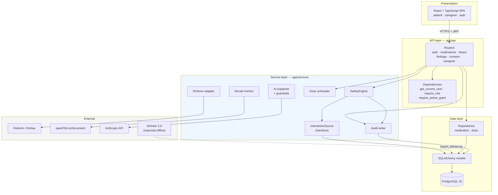
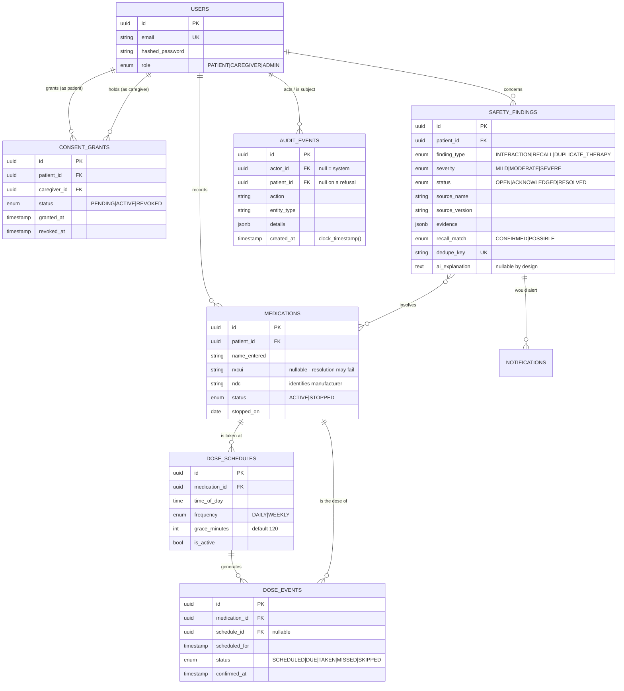
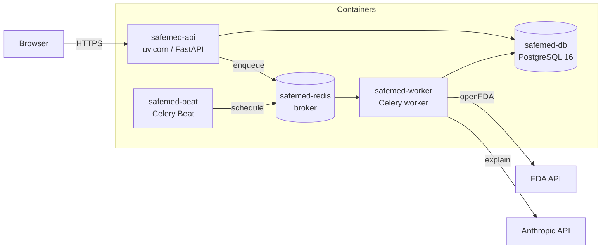
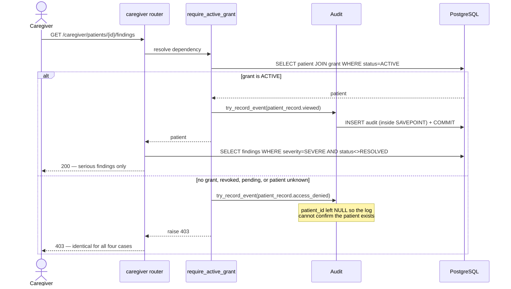
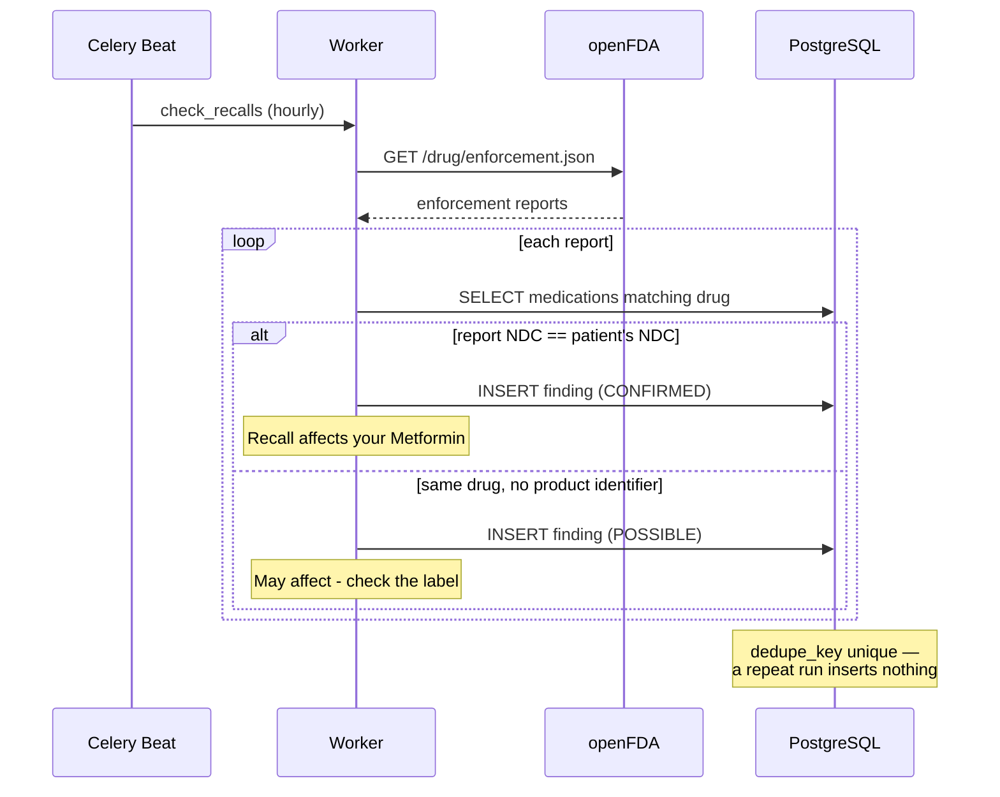

# SafeMed — Software Architecture and Design

**CSCI 4490 Software Engineering · Fall 2026 · University of Central Arkansas**

Document version 1.0 · 24 November 2026
Companion to [REQUIREMENTS.md](REQUIREMENTS.md). Rationale for each decision is in [HANDBOOK.md](HANDBOOK.md).

Diagrams are Mermaid and render directly on GitHub.

---

## 1. Architectural Overview

SafeMed is a **modular monolith with an asynchronous worker**. One deployable
application containing clearly separated modules, plus a background worker
sharing the same codebase and database.

### 1.1 Why not microservices

A three-person team with one semester cannot operate a distributed system and
also build the thing it is distributing. Microservices would add network
failure, deployment coordination and distributed debugging to a project whose
actual difficulty is drug-data correctness. The module boundaries here are
real and enforced by import direction — if the system ever needed splitting,
the seams already exist.

### 1.2 The governing principle

```
Authoritative data → Deterministic engine → Verified finding → AI explains it
```

Safety determination is deterministic and sourced. AI is downstream of the
finding and never upstream of it. This single arrow direction is what keeps
the system out of BC-01 and BC-03 territory.

---

## 2. Logical View — Modules



### 2.1 Enforced dependency direction

Verified by inspection of imports: **no module in `app/services/` or
`app/repositories/` imports from `app/api/`.** Dependencies point inward
only. The HTTP layer knows about services; services do not know they are
being called over HTTP, which is why they are testable without a request.

### 2.2 Module responsibilities

| Module | Responsibility | Must not |
|---|---|---|
| `app/api` | Validate input, call a service, shape a response | Contain business logic |
| `app/services` | Safety evaluation, external adapters, scheduling, audit, AI | Know about HTTP |
| `app/repositories` | Database queries | Contain safety rules |
| `app/models` | Table definitions and constraints | Contain behaviour beyond invariants |
| `app/schemas` | Request/response contracts and validation | Touch the database |
| `app/workers` | Scheduled and queued jobs | Duplicate service logic |

---

## 3. Data Model



### 3.1 Three decisions visible in the schema

**`rxcui` is nullable.** RxNorm being unreachable must not prevent a patient
recording a medication they are actually taking. The interface then says
"Checked by name only" rather than implying full coverage (FR-05, NFR-05).

**`dedupe_key` is unique and hashes the finding's *subject*, never the time.**
This is what makes re-evaluation idempotent: the same two drugs produce the
same key, so a second run updates nothing (FR-12, NFR-06).

**`ai_explanation` is nullable.** Four different failures land here — AI
disabled, API unreachable, guardrail rejection, job not yet run — and in all
four the finding still displays, because `detail` was written by the
deterministic engine (AIR-05).

---

## 4. Process View — Runtime



### 4.1 Scheduled jobs

| Job | Cadence | Purpose |
|---|---|---|
| `check_recalls` | hourly, on the hour | Query openFDA for new enforcement reports (FR-13) |
| `refresh_dose_statuses` | every 15 minutes | Move elapsed doses to MISSED past their grace period (FR-19) |
| `explain_findings` | every 10 minutes | Generate plain-language explanations for findings lacking one (UR-10) |

Every job is idempotent. The recall check writes nothing new when it finds
nothing new, verified at 0 duplicates across three full re-runs.

---

## 5. Key Scenarios

### 5.1 Adding a medication (FR-04, FR-05, FR-08)

```mermaid
sequenceDiagram
    actor P as Patient
    participant API as medications router
    participant R as Repository
    participant RX as RxNorm adapter
    participant SE as SafetyEngine
    participant AU as Audit
    participant DB as PostgreSQL

    P->>API: POST /medications {name, times[]}
    API->>R: create(patient_id, name)
    R->>DB: INSERT medication
    API->>DB: INSERT dose_schedules
    API->>RX: normalize(name)
    alt RxNorm reachable
        RX-->>API: RXCUI + normalized name
        API->>R: update(rxcui)
    else unreachable or no match
        RX-->>API: not found
        Note over API: medication is kept;<br/>UI shows Checked by name only
    end
    API->>SE: evaluate_patient(patient_id)
    SE->>DB: SELECT interactions for all active meds
    SE->>DB: INSERT findings (dedupe_key unique)
    API->>AU: record_event(medication.created)
    API->>DB: COMMIT
    Note over API,DB: medication, schedules, findings and<br/>audit row commit together
    API-->>P: 201 Created
```

The ordering is deliberate: the medication is saved **before** normalisation
is attempted, so a slow or absent RxNorm cannot lose a patient's data.

### 5.2 Caregiver reads a record (FR-22, FR-25, FR-29)



The SEVERE filter is applied **in the query**, not in the response shaping.
A lesser finding is never loaded into memory on a caregiver request, so it
cannot be leaked by a later change to serialisation.

### 5.3 Recall arrives while nobody is using the app (FR-13…FR-16)



45 of 100 sampled FDA recalls carry no product identifier. Treating those as
CONFIRMED would tell a patient they were affected 45% of the time without
knowing — the measurement behind FR-14.

---

## 6. Development View — Source Organisation

```
safemed/
├── .github/workflows/ci.yml      tests · typecheck · lint · migration check
├── backend/
│   ├── alembic/versions/         4 migrations, reversible
│   ├── scripts/                  import_ddinter · resolve_rxcuis · seed_demo · evaluate
│   ├── tests/                    16 files · 194 tests
│   └── app/
│       ├── api/v1/               one router per resource
│       ├── core/                 config · security
│       ├── db/                   engine · session
│       ├── models/               tables
│       ├── schemas/              request/response contracts
│       ├── repositories/         queries
│       ├── services/             engine · adapters · audit · AI
│       └── workers/              celery_app · tasks
└── frontend/src/
    ├── api/                      the only module that calls the API
    ├── components/               shared primitives
    ├── pages/                    auth · dashboard · caregiver
    └── session/                  auth state · routing · links
```

---

## 7. Cross-Cutting Design Decisions

### 7.1 Authorization

Checked server-side on every request. `require_active_grant` re-queries the
grant each time, so revocation takes effect on the caregiver's next request
rather than at token expiry. Client-side route guards exist for usability
only and are documented as such (NFR-02).

An unknown patient and an unauthorized patient return **identical** 403
responses, so status codes cannot be used to enumerate who exists (FR-27).

### 7.2 Audit

Writes use `record_event`, which flushes into the caller's transaction and
never commits — so an action and its audit row are saved together or roll
back together (FR-33).

Reads use `try_record_event`, which wraps the write in a SAVEPOINT and never
raises. This is the single deliberate exception in the system: if the audit
write fails, a caregiver's read is still served and the failure logged
loudly, because refusing to show someone a severe interaction over a logging
failure is the greater harm. A regulated system would choose the opposite.

Append-only is enforced by SQLAlchemy `before_update` and `before_delete`
listeners that raise, not by convention (FR-32).

### 7.3 Failure degradation (NFR-05)

| Service unavailable | Behaviour |
|---|---|
| RxNorm | Medication saves; matched by name; UI says "Checked by name only" |
| openFDA | Existing findings unaffected; next scheduled run retries |
| Anthropic API | Findings display their deterministic `detail`; no explanation block |
| Audit (read path) | Request served; failure logged at ERROR |
| Audit (write path) | Action rolls back with its audit row |

Nothing on the safety path depends on an external service being reachable.

### 7.4 Why the interaction source is an interface (NFR-09)

The NLM's RxNav drug-interaction API was retired in January 2024. Building
directly on a single live API would have ended the project. `InteractionSource`
is a Protocol; DDInter is one implementation, imported offline into
`drug_interactions`. Swapping or adding a source does not touch the engine.

---

## 8. Design-Level Verification

| Design property | How it is held in place |
|---|---|
| Layering — services never depend on HTTP | Import direction, verified by inspection |
| Idempotent workers | Unique `dedupe_key`; 0 duplicates over 3 re-runs |
| Audit immutability | ORM listeners + two tests |
| Reversible schema | CI runs upgrade → downgrade → upgrade on every push |
| AI cannot determine safety | Suite passes in full with AI disabled |
| Revocation is immediate | Grant re-queried per request; test asserts next-request refusal |
